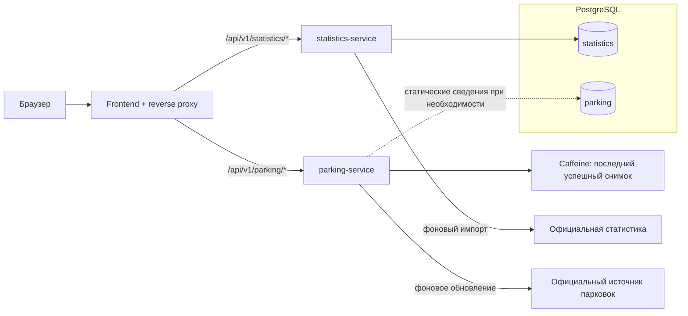

# Архитектура Cyprus Open

Статус: проект решения. Сейчас работают локальная PostgreSQL и проверка изоляции баз. Приложения и интеграции ещё не реализованы. [План](plan.md) задаёт порядок работ, [контракты](api-design.md) — предполагаемое поведение API.

## Приложения

| Проект | Ответственность | Хранение |
| --- | --- | --- |
| `frontend` | React/Vite, EN/RU/EL, ECharts, Leaflet; production-сервер также проксирует API | Только явно выбранный язык в localStorage |
| `backend/statistics-service` | Два проверенных набора, импорт, фильтры, статистический API, состояние синхронизации | База/схема `statistics`, роль `statistics_app` |
| `backend/parking-service` | Официальный источник парковок, обновление, API, свежесть | Последний успешный снимок в Caffeine; база `parking` только при необходимости static metadata |
| `backend/common-library` | Обычный JAR для действительно общего кода | Без БД, JPA-сущностей и состояния приложений |

Аптеки добавляются позже отдельным сервисом после проверки расписания. У Statistics и Parking свои процессы, `pom.xml`, Dockerfile, конфигурация, миграции и проверки. Они не вызывают друг друга при чтении.



Стрелки к официальным источникам — будущие фоновые задания. Пользовательский GET читает только нашу БД или память. Для карты отдельно выбираем провайдера подложки и атрибуцию; его запросы не должны содержать парковочную телеметрию или геолокацию пользователя.

## Сборка и структура

```text
pom.xml                         агрегатор; не приложение
backend/common-library/         обычный JAR, первоначально пустой
backend/statistics-service/      com.cyprusopen.statistics
backend/parking-service/         com.cyprusopen.parking
frontend/src/
  app/                          маршруты, providers, layout
  features/statistics/           экраны, API, графики
  features/parking/              экран, API, карта и список
  components/                   повторно используемые элементы
  locales/{en,ru,el}.json
docs/                           решения, источники, DBML, прототип
infra/postgres/                 создание локальных баз и ролей
```

Внутри сервисов код группируется по задачам: `immigration`, `tourism`, `sync`. DTO API отделяем от source DTO и JPA-сущностей. Common JAR не содержит бизнес-правил отдельных сервисов.

Java 25 установлена. Цель — стабильный Spring Boot 4.x; точную версию и совместимость зависимостей фиксируем в первом рабочем skeleton. [Официальные требования](https://docs.spring.io/spring-boot/system-requirements.html) подтверждают поддержку Java 25 текущей линией. Добавляем Maven Wrapper и frontend lockfile. Root build собирает выбранный сервис с зависимостями через `-pl … -am`; для сборки из каталога сервиса сначала устанавливаем common-library в локальный Maven repository. Внешний реестр артефактов не нужен.

## Импорт статистики

1. После проверки источника — ограниченный запрос метаданных/ресурса, с условным GET при поддержке.
2. Разбор ответа в пределах лимита; проверка измерения, периода, единиц, пропусков и уникальности ключей.
3. В одной транзакции обновление строк конкретного набора и `lastSuccessfulSyncAt`. Повторный импорт не создаёт дублей; исправления опубликованной истории обновляются.
4. Ошибка откатывает импорт и сохраняет прежние данные. Отдельно записывается безопасное описание ошибки проверки. `lastCheckedAt` и успешная синхронизация — разные события.
5. API строит рейтинг из сохранённых строк. TOTAL/EU не участвуют в рейтинге стран. Недоступные значения не превращаются в нули.

Сначала отдельный импортёр на набор, без универсального ETL. Публичного endpoint для запуска синхронизации нет; ручной импорт использует ту же политику доступа.

## Парковки

Кэш хранит ограниченный последний успешный снимок без вытеснения по короткому TTL. Новый валидный снимок заменяет его атомарно. При ошибке прежний остаётся, свежесть пересчитывается при чтении. Порог stale и предельный возраст показа задаём после проверки источника. После предельного возраста числовую доступность скрываем.

Различаем время наблюдения у источника, успешную загрузку и последнюю попытку. Повторная загрузка старого показания не делает его свежим. Если источник не сообщает время наблюдения, пишем «получено нами». До первого ответа и после рестарта — unavailable, без придуманных значений. Пропавшая из нового снимка парковка получает unknown. История занятости в PostgreSQL не записывается.

## Защита источников

Все HTTP-импорты используют одну policy: один запрос одновременно на host, минимум 5 секунд между запросами как внутренний исходный предел, таймауты, ограничение тела и бюджета задания. Более строгие опубликованные ограничения приоритетны. Retry ограничен; `Retry-After` на 429/503 переносит следующую попытку. Повторные ошибки приостанавливают задания.

Лимитер в памяти действует только внутри процесса. В MVP каждому upstream-host назначаем одного владельца и одну активную копию scheduler. Если два сервиса потребуют один host, второй fetch остаётся выключен до выбора общей координации. При обновлении scheduler сначала останавливаем прежний и ждём окончания задания; rolling deploy с двумя активными scheduler недопустим. Масштабирование требует распределённой блокировки до включения дополнительных копий.

| Переменная приложения | Назначение / начальное значение |
| --- | --- |
| `PORT` | HTTP-порт Railway; локально разные порты 8081/8082 |
| `SPRING_DATASOURCE_URL/USERNAME/PASSWORD` | Своя база, секреты вне Git |
| `EXTERNAL_FETCH_ENABLED` | `false` локально и в CI; выключает scheduler и ручной upstream-вызов |
| `SYNC_ENABLED` | `false`, пока нет проверенного источника и владельца расписания |
| `UPSTREAM_CONTACT` | Контакт для User-Agent перед включением живых запросов |

Локальные fixture-файлы не требуют внешней сети. HTTP-тесты используют только loopback stub server, без переходов на публичные хосты.

## Эксплуатация

Один публичный origin: production HTTP-сервер frontend проксирует два API по Railway private network. Неизвестный `/api/**` возвращает JSON 404, не HTML приложения. При такой схеме CORS не нужен. Management endpoints ограничены health; ошибки не раскрывают SQL, credentials или upstream payload.

Statistics readiness проверяет БД и миграции, не доступность госисточника. Parking может быть ready с unavailable-снимком. Логи: request ID, dataset code, итог задания и число upstream-запросов; без payload/секретов и своей аналитики посещений.

Railway: отдельные сервисы, общий PostgreSQL, root build context для backend. Каждый сервис владеет миграциями своей схемы, `ddl-auto=validate`. Миграции совместимы с предыдущим релизом. См. [Railway](railway.md) и [проект хранения](storage-design.md).
