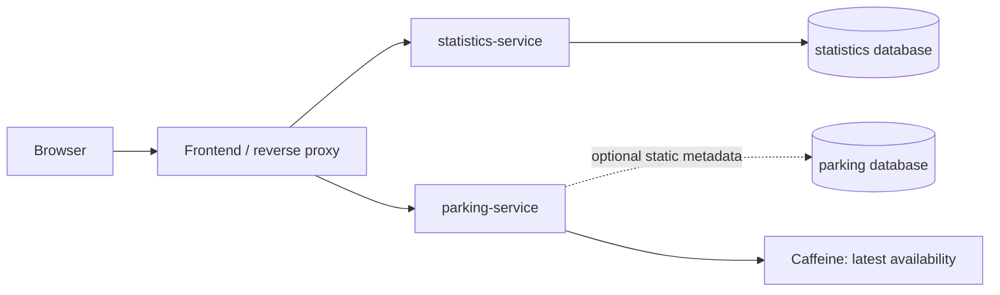

# Architecture

Only local PostgreSQL provisioning is currently prepared. Services below describe the intended boundaries; none is running yet.

Backends remain independent Spring Boot applications. A small common JAR will contain only genuinely shared code. Official data fetching will be disabled by default locally and in tests. No source integrations or schedules have been enabled.
